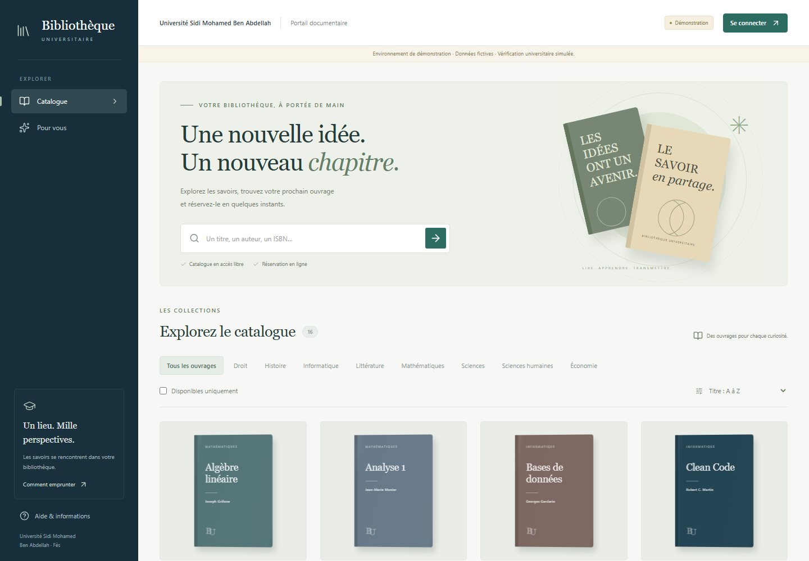

# Bibliothèque Universitaire USMBA

Application web de gestion d'une bibliothèque physique : catalogue, réservations, remises au guichet, emprunts et retours. Elle comprend un espace étudiant et un espace bibliothécaire.



## Fonctionnalités

**Étudiant** : connexion universitaire, consultation du catalogue, demande d'ouvrage, suivi des réservations et emprunts, notifications, sanctions et propositions d'acquisition. La vérification de la carte universitaire utilise une interface de scan et un contrôle côté serveur. Lorsqu'une demande est refusée, le motif apparaît sous le bouton de la fiche de l'ouvrage ; les demandes refusées ne figurent pas dans la liste « Mes demandes ».

**Bibliothécaire** : tableau de bord avec ouvrages au catalogue, exemplaires disponibles, emprunts actifs et emprunts en retard ; vue des réservations sous les indicateurs ; gestion du catalogue et des exemplaires ; confirmation des remises et retours ; suivi des sanctions, propositions et paramètres selon les habilitations du compte.

Une réservation immobilise un exemplaire accepté. L'emprunt commence seulement lorsque le bibliothécaire confirme sa remise physique. Le serveur applique la limite configurée d'emprunts et réservations actifs et empêche la création d'une demande lorsque cette limite est atteinte.

## Technologies

- Frontend : React, TypeScript, Vite, React Router et TanStack Query.
- Backend : Node.js, Express, TypeScript, Zod et Prisma.
- Base de données : PostgreSQL 16.
- Tests : Vitest, Supertest et Playwright.

## Démarrage local

Prérequis : Node.js 22.12 ou plus récent, npm et Docker Compose.

```powershell
Copy-Item .env.example .env
docker compose up -d db
npm ci
npm run db:generate
npm run db:migrate
npm run db:seed
npm run dev
```

Depuis macOS ou Linux, utiliser `cp .env.example .env` à la place de `Copy-Item`. Adapter les valeurs de `.env` à votre environnement, notamment `DATABASE_URL`, `SESSION_SECRET` et, pour la connexion Google, `GOOGLE_CLIENT_ID`. Les identifiants de `.env.example` sont réservés au développement local.

L'interface est disponible sur `http://localhost:5173` et l'API sur `http://localhost:3001`. En mode démonstration, la page de connexion propose des comptes fictifs étudiant et bibliothécaire. Le mode démonstration est interdit en production.

## Vérifications

```powershell
npm run typecheck
npm run build
npm run db:test:migrate
npm test
npm run test:e2e:isolated
```

Les tests serveur et navigateur utilisent `TEST_DATABASE_URL`, qui doit pointer vers une base distincte dont le nom se termine par `_test`. Les détails du protocole de test figurent dans [docs/testing.md](docs/testing.md) et [frontend/e2e/README.md](frontend/e2e/README.md).

## Structure du dépôt

| Chemin | Contenu |
| --- | --- |
| `frontend/` | Interface React et tests navigateur |
| `backend/` | API Express, schéma Prisma, migrations et tests serveur |
| `docs/` | Documentation, diagrammes et captures d'écran |
| `scripts/` | Outils de développement et de test isolé |

L'application distingue les rôles `STUDENT` et `LIBRARIAN`. Les opérations sensibles du personnel nécessitent des habilitations supplémentaires. Pour une exploitation institutionnelle, configurer HTTPS, Google OAuth et le connecteur universitaire officiel ; l'OCR seul ne valide pas une identité réelle.
