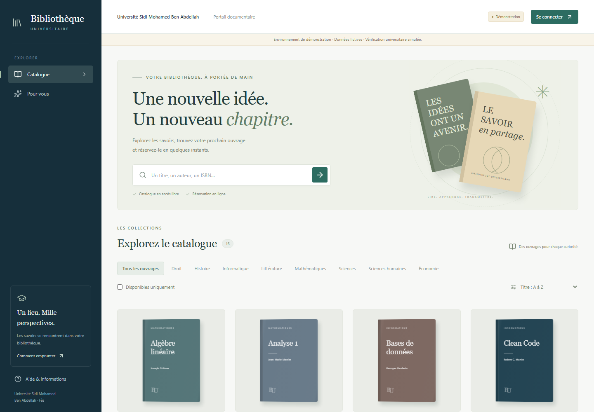
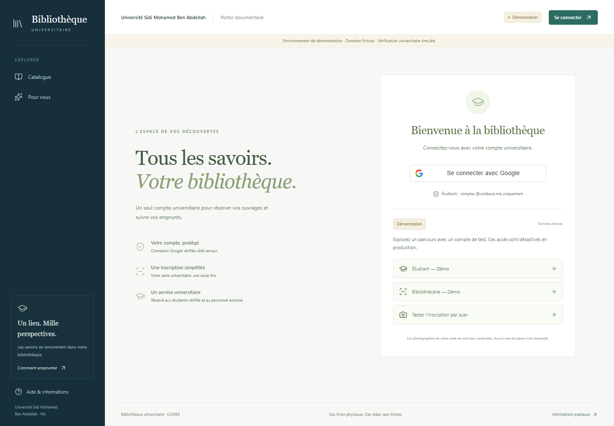
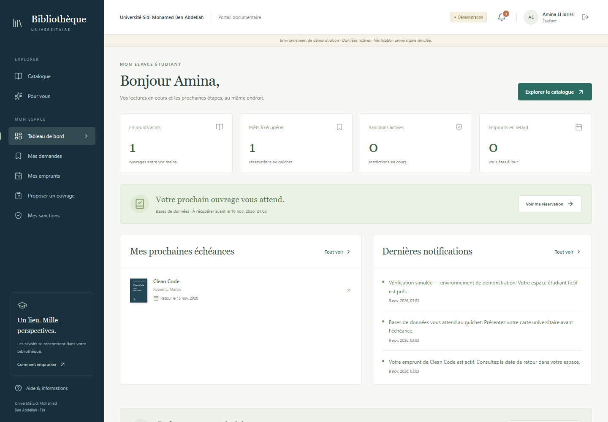
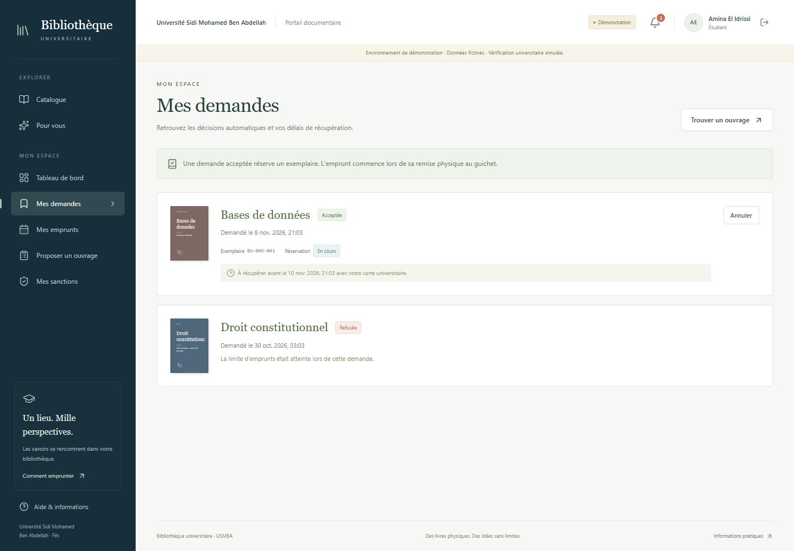
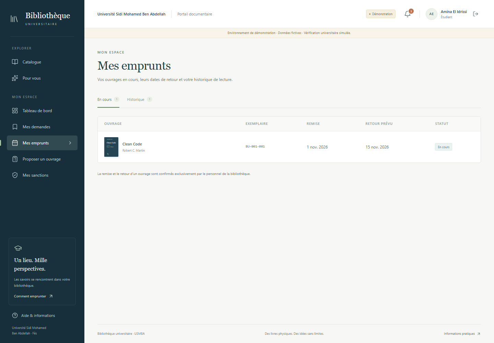
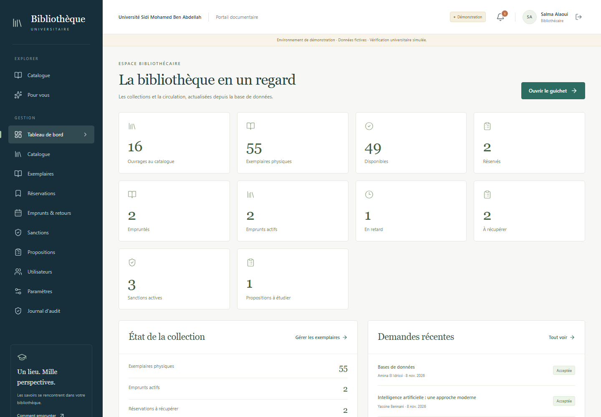
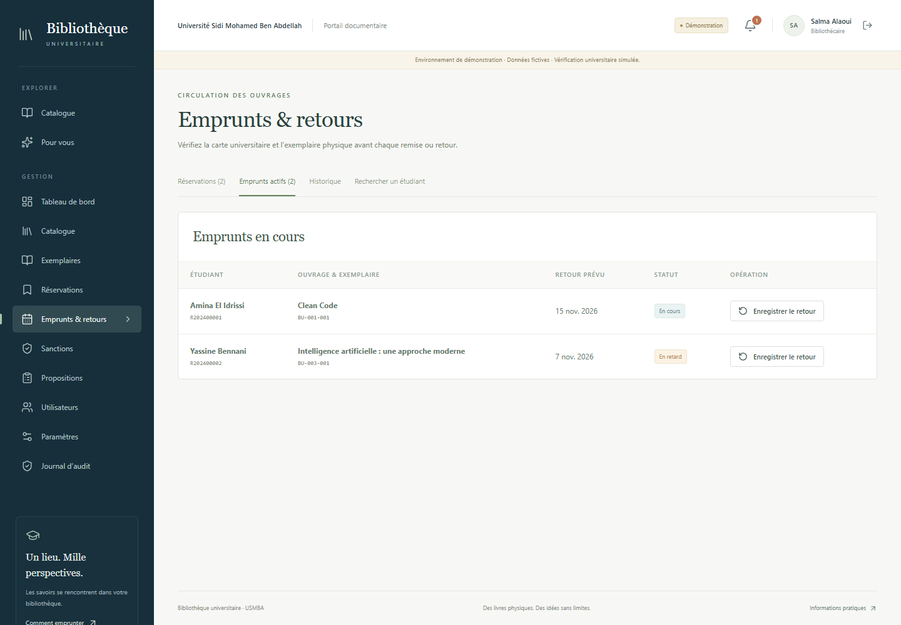
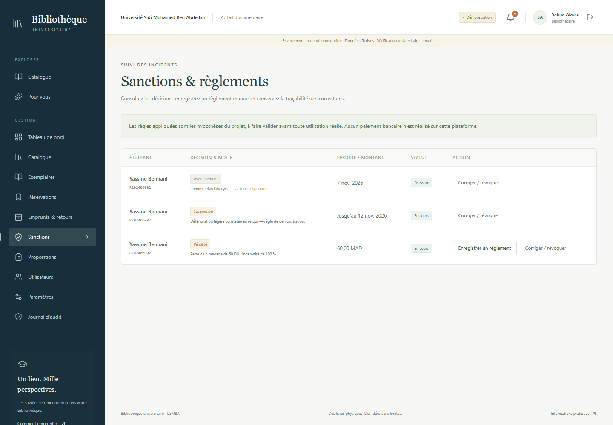
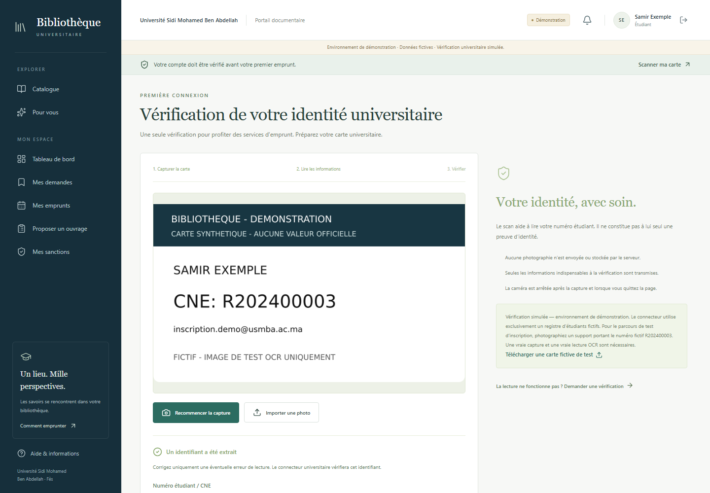

# Bibliothèque Universitaire USMBA

*Application web de gestion des ouvrages, réservations et emprunts d'une bibliothèque universitaire.*

Cette application dématérialise les procédures d'une bibliothèque physique : recherche au catalogue, demande d'ouvrage, réservation d'un exemplaire, remise au guichet et retour. Elle propose deux espaces distincts, **Étudiant** et **Bibliothécaire**. Il ne s'agit pas d'une plateforme de lecture ou de téléchargement de livres numériques.



## Fonctionnalités

| Espace étudiant | Espace bibliothécaire |
| --- | --- |
| Connexion avec un compte universitaire Google | Tableau de bord de la bibliothèque |
| Première inscription avec reconnaissance OCR de la carte | Gestion des ouvrages, auteurs, catégories et exemplaires |
| Consultation, recherche et filtrage du catalogue | Traitement des réservations et confirmation de la remise physique |
| Disponibilité des exemplaires en temps réel | Enregistrement des retours et de l'état des exemplaires |
| Demandes d'emprunt et réservations | Suivi des retards, incidents, sanctions et règlements |
| Suivi des emprunts actifs et des dates de retour | Gestion des propositions d'acquisition |
| Notifications et consultation des sanctions | Gestion des utilisateurs et contrôles physiques selon habilitation |
| Propositions d'acquisition | Configuration des paramètres métier selon habilitation |
| Recommandations selon l'historique de catégories | Consultation du journal d'audit selon habilitation |

L'application comporte uniquement les rôles métier `STUDENT` et `LIBRARIAN`. Les opérations sensibles d'un bibliothécaire sont en plus protégées par des habilitations explicites.

### Parcours d'un emprunt

1. L'étudiant consulte le catalogue et demande un ouvrage.
2. Le serveur vérifie son profil, ses sanctions, son quota et la disponibilité.
3. Si la demande est acceptée, un exemplaire est réservé pour une durée limitée.
4. L'étudiant présente sa carte à la bibliothèque.
5. Le bibliothécaire confirme la remise de l'exemplaire ; l'emprunt devient alors actif.
6. Au retour, le bibliothécaire enregistre l'état physique de l'exemplaire.
7. La disponibilité est mise à jour et les règles de retard ou d'incident sont appliquées si nécessaire.

Une **demande** est la décision sollicitée par l'étudiant. Une **réservation** immobilise temporairement un exemplaire accepté, sans créer de prêt. L'**emprunt** commence seulement après la remise physique confirmée au guichet.

## Aperçu des interfaces

| Connexion et parcours de démonstration | Tableau de bord étudiant |
| --- | --- |
|  |  |
| Demandes et réservations | Suivi des emprunts |
|  |  |
| Tableau de bord bibliothécaire | Gestion des remises et retours |
|  |  |
| Sanctions et règlements | Inscription OCR de démonstration |
|  |  |

Des captures supplémentaires de la recherche au catalogue et des paramètres métier sont disponibles dans [`docs/screenshots`](docs/screenshots/).

## Technologies

| Couche | Technologies utilisées |
| --- | --- |
| Frontend | React 19, TypeScript, Vite 7, React Router, TanStack Query, Tailwind CSS |
| Backend | Node.js, Express 4, TypeScript, Zod |
| Données | PostgreSQL 16, Prisma 6.19.0 |
| Authentification | Google Identity Services, sessions serveur sécurisées, contrôle des rôles et habilitations |
| OCR et images | Tesseract.js, Sharp |
| Tests | Vitest, Supertest, Playwright Chromium |
| Environnement local | Docker Compose, monorepo npm workspaces |

## Installation locale

### Prérequis

- Node.js 22.12 ou version ultérieure ;
- npm ;
- Docker Desktop avec Docker Compose ;
- Git.

### Préparer le projet

```powershell
git clone <URL_DU_DEPOT>
cd library-management
Copy-Item .env.example .env
docker compose up -d db
npm ci
npm run db:generate
npm run db:migrate
npm run db:seed
```

Sous macOS ou Linux, remplacer `Copy-Item .env.example .env` par `cp .env.example .env`.

Le fichier `.env.example` contient uniquement une configuration locale fictive. Avant de démarrer, adapter si nécessaire `DATABASE_URL`, `TEST_DATABASE_URL`, `APP_ORIGIN` et `SESSION_SECRET`. Pour la connexion Google réelle, renseigner le `GOOGLE_CLIENT_ID` d'un client Web et déclarer `http://localhost:5173` parmi ses origines JavaScript autorisées.

Les migrations Prisma préparent une base neuve sans recommander ni exécuter de réinitialisation d'une base existante. Le seed ajoute le catalogue fictif lorsqu'il est absent.

### Démarrer l'application

```powershell
npm run dev
```

L'interface est disponible sur [http://localhost:5173](http://localhost:5173) et l'API Express sur `http://localhost:3001`. La commande démarre simultanément le frontend et le backend.

> Une utilisation institutionnelle nécessite en plus une configuration Google valide, HTTPS et un connecteur universitaire officiel. L'OCR seul n'active jamais un compte Google réel lorsque ce connecteur n'est pas configuré.

## Mode démonstration

Avec `DEMO_MODE=true` et `NODE_ENV=development`, la page `/connexion` propose trois parcours indépendants de Google OAuth :

- **Étudiant — Démo** ouvre un compte étudiant fictif et son espace personnel ;
- **Bibliothécaire — Démo** ouvre un compte bibliothécaire fictif et l'espace de gestion ;
- **Tester l'inscription par scan** lance une première inscription fictive. Importer [`frontend/public/demo-card.png`](frontend/public/demo-card.png), puis lancer l'OCR pour reconnaître le numéro `R202400003`.

Les comptes, le catalogue et la carte sont entièrement fictifs. Ce parcours OCR illustre le fonctionnement technique mais ne constitue pas une vérification universitaire officielle. Le serveur refuse le mode démonstration en production ; `DEMO_MODE` doit y rester désactivé.

## Tests

Les validations exécutées sur une base PostgreSQL isolée donnent les résultats suivants :

- **74/74 tests serveur réussis** avec Vitest et Supertest ;
- **4/4 scénarios Playwright Chromium réussis** : inscription OCR, circulation étudiant/bibliothécaire et cas caméra ;
- **OCR Tesseract.js validé** sur la carte synthétique avec reconnaissance de `R202400003` ;
- vérification TypeScript et builds backend/frontend réussis.

```powershell
npm run typecheck
npm run build
npm run test:ocr
npm run test:e2e:isolated
```

Les tests serveur et navigateur exigent une base dédiée dont le nom se termine par `_test`. Ils refusent la base principale. Les résultats détaillés et les limites de validation externe sont documentés dans [`docs/testing.md`](docs/testing.md).
